<!-- =============== CINEMATIC HERO =============== -->

  

  

  

 

<!-- =============== ABOUT =============== -->

  

  Hello! I'm <b>Gade Ameesha</b>, a Computer Science graduate passionate about Software Development and Quality Assurance.

  I enjoy developing practical applications, exploring technologies, identifying software defects and improving application quality.

  ✦ Software Developer

  ✦ QA Engineer

  ✦ Python & SQL Enthusiast

  ✦ Manual Testing & Test Case Design

  ✦ Continuous Learner

 

<!-- =============== SKILLS =============== -->

  

<h3 align="center">Programming Languages</h3>

  

<h3 align="center">Testing Skills</h3>

  
  
  
  
  
  

<h3 align="center">Tools & Technologies</h3>

  

  
  

 

<!-- =============== EXPERIENCE =============== -->

  

### Tester Trainee — MSC Technologies

**April 2026 – September 2026**

- Gained practical exposure to software testing concepts.
- Created and executed test cases for a live Maintenance & Repair (M&R) application.
- Practiced manual testing and defect identification.
- Learned functional and regression testing concepts.
- Experienced real-world testing workflows.

 

<!-- =============== PROJECTS =============== -->

  

  <i>Selected work in Quality Assurance, Software Development and Data Analytics.</i>

<table>
<tr>
<td width="50%" valign="top">

<h3>01 | E-commerce Manual Testing</h3>

**Focus:** Manual QA Testing

- Test scenarios and test cases
- Test data preparation
- Defect reporting
- E-commerce application testing

</td>
<td width="50%" valign="top">

<h3>02 | Login Page Manual Testing</h3>

**Focus:** Functional Testing

- Login test scenarios
- Positive and negative test cases
- Defect identification
- Test documentation

</td>
</tr>
<tr>
<td width="50%" valign="top">

<h3>03 | PasswordVault</h3>

**Technologies:** Python · Flask · SQLite

- Password management application
- PIN-based authentication
- TOTP two-factor authentication
- Encrypted password storage

</td>
<td width="50%" valign="top">

<h3>04 | Enterprise Sales Analytics</h3>

**Technologies:** SQL · Excel

- Enterprise sales data analysis
- SQL-based data exploration
- Excel dashboard development
- Business sales insights

</td>
</tr>
</table>

 

<!-- =============== EDUCATION =============== -->

  

### Dr. M.G.R. Educational and Research Institute

**Computer Science and Engineering**

CGPA: **8.8**

 

<!-- =============== CERTIFICATIONS =============== -->

  

| Certification | Organization |
|:---|:---:|
| Python for Data Science | NPTEL |
| Data Science for Engineers | NPTEL |
| Python Essentials | Cisco |
| RH124 | Red Hat |

 

<!-- =============== GITHUB ACTIVITY =============== -->

  

  

 

<!-- =============== CONNECT =============== -->

  

  
  

 

<!-- =============== FOOTER =============== -->

  

<h3 align="center">✦ BUILD • TEST • LEARN • IMPROVE ✦</h3>

  <i>"Great software is built with creativity, tested with precision, and improved with consistency."</i>

  <b>Thank you for visiting my profile! ❤️</b>

