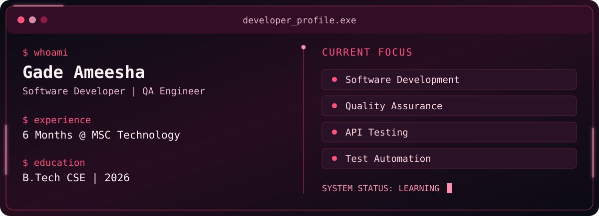
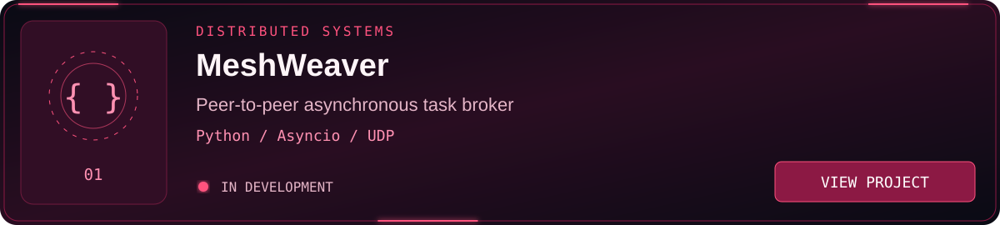
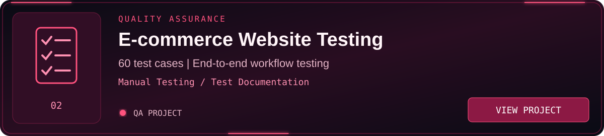
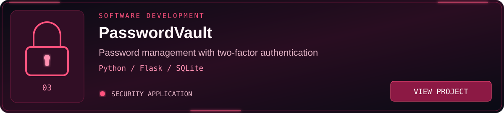
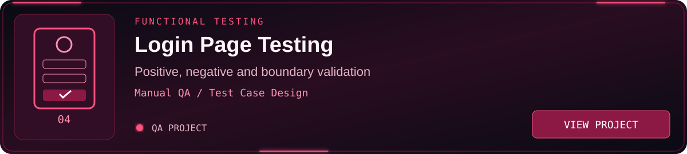
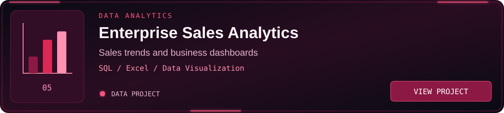

<!-- ================= HERO ================= -->

 

 

<!-- ================= ABOUT ME ================= -->

<h2 align="center">✦ 01 / ABOUT ME ✦</h2>

  

  Computer Science Engineering graduate with six months of internship experience in Software Development and Quality Assurance at MSC Technology.

  Passionate about building reliable applications, identifying defects, exploring automation and solving real-world problems through technology.

  
  
  
  

<!-- ================= TECH STACK ================= -->

<h2 align="center">✦ 02 / TECH ARSENAL ✦</h2>

<h3 align="center">Programming Languages</h3>

  

<h3 align="center">Frontend Development</h3>

  

<h3 align="center">Backend & Databases</h3>

  

  
  

<h3 align="center">Quality Assurance</h3>

| Testing Knowledge | Testing Processes |
|:---|:---|
| Manual Testing | SDLC & STLC |
| Functional Testing | Test Scenario Design |
| Regression Testing | Test Case Execution |
| Smoke & Sanity Testing | Defect Reporting |
| Black Box Testing | Test Documentation |

<h3 align="center">API & Automation — Learning and Practice</h3>

  

  
  
  
  

<h3 align="center">Data Science & Machine Learning</h3>

  
  
  
  
  

<h3 align="center">Development Tools</h3>

  

  
  

<!-- ================= EXPERIENCE ================= -->

<h2 align="center">✦ 03 / MY JOURNEY ✦</h2>

### MSC Technology (India) Pvt. Ltd.

**Apprenticeship Trainee — Software Development & QA**

- Contributed to software development and quality assurance activities.
- Created and executed manual test cases for an enterprise Maintenance & Repair application.
- Designed positive and negative testing scenarios.
- Worked on defect identification and test documentation.
- Gained exposure to Azure DevOps, C# and Playwright.
- Developed an understanding of enterprise software and shipping domain workflows.

---

### Infotact Solutions

**Python Development Intern**

- Collaborating on MeshWeaver, a zero-dependency P2P asynchronous task broker.
- Working with Python, asyncio and UDP communication.
- Contributing to distributed task processing.
- Using Git and GitHub for collaborative software development.

<!-- ================= PROJECTS ================= -->

<h2 align="center">✦ 04 / PROJECT SHOWCASE ✦</h2>

  <i>Turning ideas into practical engineering solutions.</i>

  

  

  

  

  

  

<!-- ================= CURRENT FOCUS ================= -->

<h2 align="center">✦ 05 / CURRENT FOCUS ✦</h2>

<table>
<tr>
<td width="50%" valign="top">

<h3>Software Development</h3>

<ul>
  <li>Python Development</li>
  <li>Distributed Systems</li>
  <li>Asynchronous Programming</li>
</ul>

</td>

<td width="50%" valign="top">

<h3>Quality Engineering</h3>

<ul>
  <li>Manual Software Testing</li>
  <li>API Testing with Postman</li>
  <li>Playwright with C#</li>
  <li>Selenium with Java and Python</li>
</ul>

</td>
</tr>

<tr>
<td width="50%" valign="top">

<h3>Continuous Learning</h3>

<ul>
  <li>Advanced JavaScript</li>
  <li>Backend Development</li>
  <li>Automation Frameworks</li>
</ul>

</td>

<td width="50%" valign="top">

<h3>Career Goals</h3>

<ul>
  <li>Software Developer</li>
  <li>QA Engineer</li>
  <li>Building reliable software</li>
</ul>

</td>
</tr>
</table>

  

<!-- ================= GITHUB ANALYTICS ================= -->

<h2 align="center">✦ 06 / GITHUB ANALYTICS ✦</h2>

  

  

<!-- ================= CONTRIBUTION SNAKE ================= -->

<h3 align="center">🐍 Contribution Journey</h3>

  <i>Every contribution is a step towards better engineering.</i>

  <picture>
    <source media="(prefers-color-scheme: dark)" srcset="https://raw.githubusercontent.com/GadeAmeesha/GadeAmeesha/output/github-snake-dark.svg"/>
    <source media="(prefers-color-scheme: light)" srcset="https://raw.githubusercontent.com/GadeAmeesha/GadeAmeesha/output/github-snake.svg"/>
    
  </picture>

<!-- ================= EDUCATION ================= -->

<h2 align="center">✦ 07 / EDUCATION ✦</h2>

<h3>Dr. M.G.R. Educational and Research Institute</h3>

<strong>Bachelor of Technology</strong>

Computer Science and Engineering

<!-- ================= CERTIFICATIONS ================= -->

<h2 align="center">✦ 08 / CREDENTIALS ✦</h2>

| Certification | Issuing Organization |
|:---|:---:|
| Python for Data Science | NPTEL |
| Data Science for Engineers | NPTEL |
| Python Essentials | Cisco |
| Red Hat System Administration I — RH124 | Red Hat |
| Database Management System — Oracle SQL | Infosys Springboard |

<!-- ================= CONNECT ================= -->

<h2 align="center">✦ 09 / LET'S CONNECT ✦</h2>

  Open to software development, quality assurance and collaborative project opportunities.

 

<!-- ================= ANIMATED FOOTER ================= -->

<strong>Designed with passion. Driven by curiosity.</strong>

✦ BUILD • TEST • INNOVATE • EVOLVE ✦

